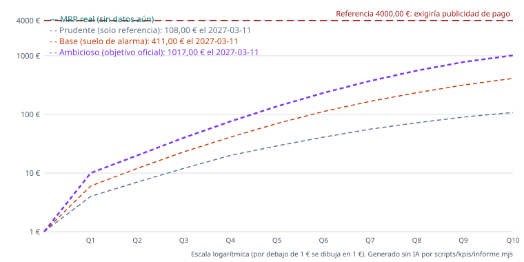

# KPIs de Costaviva

Generado sin IA por `scripts/kpis/informe.mjs` el 2026-10-11 con datos hasta el 2026-10-10 (`datos-robots/kpis/historico.jsonl`). No se edita a mano.

**Fuentes:** Supabase ✅ · Stripe ⚠️ sin clave `STRIPE_KPI_KEY`: MRR a precio de lista desde `suscripciones`, sin facturado ni cancelaciones · último dato 2026-10-10.

**Objetivo:** Ambicioso (objetivo oficial) · **suelo de alarma:** Base (suelo de alarma) · prudente solo como referencia. Verde si el real llega al ambicioso; ámbar si está entre el base y el ambicioso; rojo si queda por debajo del base. Para cada paso del embudo, lo mismo con los objetivos que salen de cada escenario. Sin ajustes estacionales.

## Estrella polar: MRR

- **MRR real:** 0,00 € (precio de lista desde Supabase) · objetivo hoy 0,00 € (suelo 0,00 €) · = 0 % · 🟢 verde
- **Suscriptores de pago:** 0 mensuales y 0 anuales · en prueba con tarjeta en Stripe: 0 · con baja programada: —
- **ARPU:** 3,25 € (supuesto de objetivos.json hasta tener datos) · precios de hoy 3,99 €/mes y 29,99 €/año
- **Usuarios:** 2 cuentas válidas (sin admin, pruebas ni accesos regalados) · activos en 7 días: 1
- **Referencia de 4000,00 € el 2027-03-11:** Objetivo inicial de Mikel (duplicar cada 15 días). Queda solo como referencia: exigiría publicidad de pago.



## Árbol de KPIs

```
MRR (€/mes) = suscriptores de pago × ARPU
├─ Pagos nuevos = altas × (prueba → pago)
│  ├─ Altas = visitas × (visita → alta)      [canales: Google, Instagram, socios, directo, otros]
│  ├─ Activación: usa la app 2 días distintos de su primera semana y hace algo más que mirar el mapa
│  └─ Prueba gratis desde el alta (toda alta es una prueba)
├─ − Cancelaciones (retención semana 4)
└─ ARPU = MRR / suscriptores (lista: 3,99 €/mes; 29,99 €/año = 2,50 €/mes)
```

## Por quincena (acumulado de cada quincena)

| Quincena | Días | MRR real | MRR objetivo | Desv. | Estado | Visitas | Altas | Activ. | Pagos nuevos | Facturado |
|---|---|---|---|---|---|---|---|---|---|---|

Celdas: real / objetivo (prorrateado si la quincena está en curso).

## Por semana (lunes a domingo)

### Semana del 2026-10-05 (en curso, 6/7 días)

| KPI | Real | Objetivo (ambicioso) | Suelo (base) | Desviación | Estado |
|---|---|---|---|---|---|
| MRR (€/mes, anuales a 1/12) | 0,00 € | 0,00 € | 0,00 € | = 0 % | 🟢 verde |
| Suscriptores de pago | 0 | 0 | 0 | = 0 % | 🟢 verde |
| Facturado (€ cobrados) | — | 0,00 € | 0,00 € | — | ⚪ sin dato |
| Visitas a páginas públicas | 63 | — | — | — | ⚪ sin dato |
| Altas (pruebas gratis) | 1 | 0 | 0 | ▲ — | 🟢 verde |
| Activaciones (cohortes que cumplen 7 días) | — | 0 | 0 | — | ⚪ sin dato |
| Pagos nuevos | 0 | 0 | 0 | = 0 % | 🟢 verde |
| Cancelaciones (máximo) | — | 0 | — | — | ⚪ sin dato |
| Retención semana 4 (%) | — | — | — | — | ⚪ sin dato |

### Semana del 2026-09-28

| KPI | Real | Objetivo (ambicioso) | Suelo (base) | Desviación | Estado |
|---|---|---|---|---|---|
| MRR (€/mes, anuales a 1/12) | — | 0,00 € | 0,00 € | — | ⚪ sin dato |
| Suscriptores de pago | — | 0 | 0 | — | ⚪ sin dato |
| Facturado (€ cobrados) | — | 0,00 € | 0,00 € | — | ⚪ sin dato |
| Visitas a páginas públicas | — | — | — | — | ⚪ sin dato |
| Altas (pruebas gratis) | 0 | 0 | 0 | = 0 % | 🟢 verde |
| Activaciones (cohortes que cumplen 7 días) | — | 0 | 0 | — | ⚪ sin dato |
| Pagos nuevos | 0 | 0 | 0 | = 0 % | 🟢 verde |
| Cancelaciones (máximo) | — | 0 | — | — | ⚪ sin dato |
| Retención semana 4 (%) | — | — | — | — | ⚪ sin dato |

### Semana del 2026-09-21

| KPI | Real | Objetivo (ambicioso) | Suelo (base) | Desviación | Estado |
|---|---|---|---|---|---|
| MRR (€/mes, anuales a 1/12) | — | 0,00 € | 0,00 € | — | ⚪ sin dato |
| Suscriptores de pago | — | 0 | 0 | — | ⚪ sin dato |
| Facturado (€ cobrados) | — | 0,00 € | 0,00 € | — | ⚪ sin dato |
| Visitas a páginas públicas | — | — | — | — | ⚪ sin dato |
| Altas (pruebas gratis) | 0 | 0 | 0 | = 0 % | 🟢 verde |
| Activaciones (cohortes que cumplen 7 días) | — | 0 | 0 | — | ⚪ sin dato |
| Pagos nuevos | 0 | 0 | 0 | = 0 % | 🟢 verde |
| Cancelaciones (máximo) | — | 0 | — | — | ⚪ sin dato |
| Retención semana 4 (%) | — | — | — | — | ⚪ sin dato |

### Semana del 2026-09-14

| KPI | Real | Objetivo (ambicioso) | Suelo (base) | Desviación | Estado |
|---|---|---|---|---|---|
| MRR (€/mes, anuales a 1/12) | — | 0,00 € | 0,00 € | — | ⚪ sin dato |
| Suscriptores de pago | — | 0 | 0 | — | ⚪ sin dato |
| Facturado (€ cobrados) | — | 0,00 € | 0,00 € | — | ⚪ sin dato |
| Visitas a páginas públicas | — | — | — | — | ⚪ sin dato |
| Altas (pruebas gratis) | 0 | 0 | 0 | = 0 % | 🟢 verde |
| Activaciones (cohortes que cumplen 7 días) | 0 | 0 | 0 | = 0 % | 🟢 verde |
| Pagos nuevos | 0 | 0 | 0 | = 0 % | 🟢 verde |
| Cancelaciones (máximo) | — | 0 | — | — | ⚪ sin dato |
| Retención semana 4 (%) | — | — | — | — | ⚪ sin dato |

## Línea base: antes del inicio (2026-09-15 → 2026-10-10)

Altas 1 (confirmadas 1) · visitas medidas 63 (el contador empezó el 2026-10-10) · pagos nuevos 0 · personas que abrieron el pago 0 · cancelaciones — · facturado —.

## Canales de origen

| Canal | Altas (quincena) | Pagos (quincena) | Altas (total) | Pagos (total) |
|---|---|---|---|---|
| Google y buscadores | 0 | 0 | 0 | 0 |
| Instagram y Facebook | 0 | 0 | 0 | 0 |
| Socios (códigos) | 0 | 0 | 0 | 0 |
| Directo o desconocido | 0 | 0 | 1 | 0 |
| Otros (WhatsApp, email, amigos...) | 0 | 0 | 0 | 0 |

## Canal socios: ranking

Sin datos: hace falta `STRIPE_KPI_KEY` (los códigos de socio se leen de Stripe).

## Objetivos quincenales del embudo (Ambicioso (objetivo oficial); entre paréntesis, el suelo)

Tasas usadas: visita → alta 0.0 % (real, n=63); alta → pago 3.0 % (supuesto; real con n=1, hace falta 20); alta → activación 40.0 % (supuesto; real con n=1, hace falta 20); ARPU 3,25 €; +15 % de pagos para reponer bajas.

| Quincena | Cierre | MRR ambicioso (objetivo) | MRR base (suelo) | MRR prudente (ref.) | Pagos nuevos | Altas | Activaciones | Visitas |
|---|---|---|---|---|---|---|---|---|
| Q1 | 2026-10-26 | 10,00 € | 6,00 € | 4,00 € | 4 (3) | 134 (100) | 54 (40) | Infinity (Infinity) |
| Q2 | 2026-11-10 | 20,00 € | 12,00 € | 7,00 € | 4 (3) | 134 (100) | 54 (40) | Infinity (Infinity) |
| Q3 | 2026-11-25 | 40,00 € | 23,00 € | 12,00 € | 8 (4) | 267 (134) | 107 (54) | Infinity (Infinity) |
| Q4 | 2026-12-10 | 76,00 € | 41,00 € | 20,00 € | 13 (7) | 434 (234) | 174 (94) | Infinity (Infinity) |
| Q5 | 2026-12-25 | 137,00 € | 70,00 € | 29,00 € | 22 (11) | 734 (367) | 294 (147) | Infinity (Infinity) |
| Q6 | 2027-01-09 | 233,00 € | 112,00 € | 41,00 € | 34 (15) | 1134 (500) | 454 (200) | Infinity (Infinity) |
| Q7 | 2027-01-24 | 372,00 € | 167,00 € | 56,00 € | 50 (20) | 1667 (667) | 667 (267) | Infinity (Infinity) |
| Q8 | 2027-02-08 | 559,00 € | 234,00 € | 72,00 € | 67 (24) | 2234 (800) | 894 (320) | Infinity (Infinity) |
| Q9 | 2027-02-23 | 782,00 € | 316,00 € | 90,00 € | 79 (30) | 2634 (1000) | 1054 (400) | Infinity (Infinity) |
| Q10 | 2027-03-11 | 1017,00 € | 411,00 € | 108,00 € | 84 (34) | 2800 (1134) | 1120 (454) | Infinity (Infinity) |

## Cambios de la rutina y su evaluación

Ninguno todavía.

## Cómo se calcula

- **Datos:** `kpis.yml` cada mañana lee producción SOLO en lectura (Supabase por REST con la service_role; Stripe con una clave restringida de lectura) y añade al histórico una línea por día cerrado. El histórico nunca se reescribe.
- **Altas** excluyen al admin, las cuentas de pruebas automáticas, los accesos permanentes y las invitaciones del 100 % (igual que `metricas_captacion()`).
- **Estado:** 🟢 llega al objetivo (ambicioso); 🟠 entre el suelo (base) y el objetivo; 🔴 por debajo del suelo. Cancelaciones: 🟢 hasta el máximo previsto, 🟠 hasta un 30 % más. En una quincena o semana en curso los flujos se comparan con el objetivo prorrateado.
- **Objetivos:** `datos-robots/kpis/objetivos.json` (se cambian ahí, sin tocar código).
